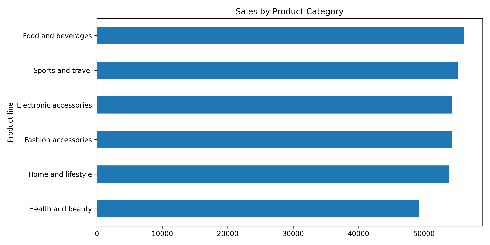
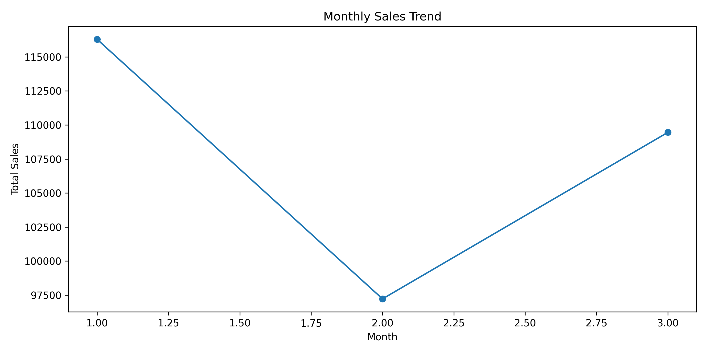
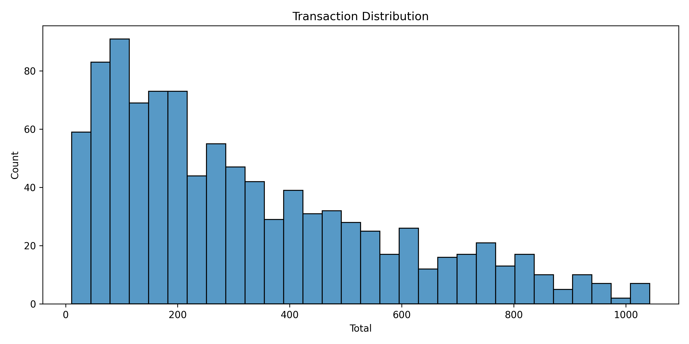
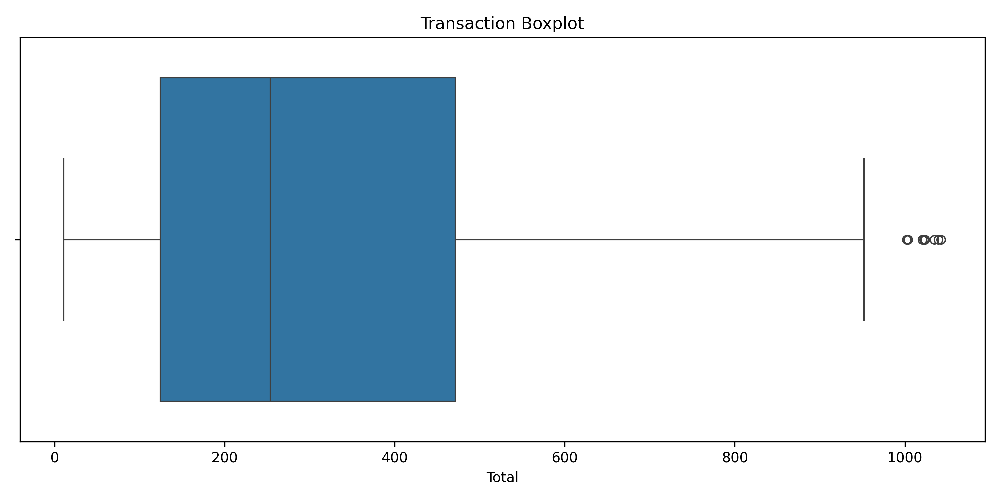

# Retail Sales Performance Analysis

## About This Project
This project analyzes 1,000 supermarket transactions using Python to identify sales trends and business insights.

## Technologies Used
- Python
- Pandas
- Matplotlib
- Seaborn
- Google Colab

## What I Did
- Imported and explored sales data.
- Checked data quality.
- Calculated sales KPIs.
- Analyzed sales by city, category, and month.
- Created four data visualizations.
- Documented findings and limitations.

## Data Visualizations

### 1. Sales by Product Category

### 2. Monthly Sales Trend

### 3. Transaction Distribution

### 4. Transaction Boxplot

## Dataset
Public Supermarket Sales dataset, January–March 2019.

## Author
Maria Guedada
  
